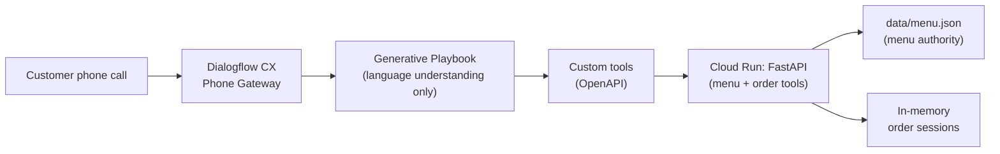

# Golden Wok — Voice Ordering POC

A lightweight proof-of-concept for an **AI-powered restaurant voice ordering
system**: a customer calls a phone number, speaks naturally, and places /
modifies a restaurant order through a Dialogflow CX **Generative Playbook**,
with a deterministic Python/FastAPI backend as the sole authority for menu,
prices, modifiers, and totals.

The experiment answers one question:

> *Can a customer naturally order restaurant food through a phone conversation
> using Dialogflow CX generative conversational capabilities plus deterministic
> backend tools?*

This is **not** a production system. See [Known POC Limitations](#known-poc-limitations).

## Architecture



The conversational agent performs **language understanding**. The backend
performs **business validation**. The LLM never invents menu items, prices,
sizes, modifiers, or availability — every fact comes from a tool call.

### Backend endpoints → Dialogflow tools

| HTTP endpoint | Dialogflow tool (`dialogflow/tool-specs/`) | Purpose |
|---|---|---|
| `GET /tools/menu` | `get_menu.yaml` | Full menu (items, prices, modifiers) |
| `GET /tools/menu/search?q=` | `search_menu.yaml` | Fuzzy/keyword menu search |
| `POST /tools/order/update` | `update_order.yaml` | Add / remove / modify order lines (validates everything, computes prices) |
| `GET /tools/order/{session_id}` | `get_order.yaml` | Current order state + backend-calculated subtotal |
| `POST /tools/order/submit` | `submit_order.yaml` | Submit after explicit confirmation; returns `GW-####` |

Error responses always use `{"error": {"code", "message", "details"}}` with
LLM-readable codes (`item_not_found`, `missing_required_modifiers`,
`ambiguous_item_reference`, `order_locked`, …). The playbook translates them
into plain speech.

### Repository structure

```
voice-ordering-poc/
├── app/
│   ├── main.py           # Thin FastAPI routes + structured logging
│   ├── models.py         # Pydantic v2 contract models
│   ├── menu_service.py   # Menu authority: load + search menu.json
│   ├── order_service.py  # ALL order business logic + pricing (cents)
│   └── session_store.py  # Abstract SessionStore + in-memory implementation
├── data/
│   └── menu.json         # Golden Wok menu: 19 items, 6 categories
├── tests/
│   ├── test_menu_service.py
│   ├── test_order_service.py
│   └── test_api.py
├── dialogflow/
│   ├── playbook.md       # Goal + Instructions + 6 few-shot examples
│   └── tool-specs/       # OpenAPI 3.0 specs for the 5 custom tools
├── scripts/
│   └── e2e.sh            # End-to-end curl test (no Dialogflow needed)
├── review/               # Architecture / code / conversation self-reviews
├── Dockerfile
├── requirements.txt
├── .env.example
└── README.md
```

## Quick Start

```bash
git clone <repo-url> voice-ordering-poc
cd voice-ordering-poc

python3.12 -m venv .venv
source .venv/bin/activate
pip install -r requirements.txt

# Run the API
uvicorn app.main:app --port 8000

# Run the tests
python -m pytest -q

# Build the Docker image (needs Docker installed)
docker build -t golden-wok-ordering .

# Run the image locally
docker run -p 8080:8080 golden-wok-ordering
```

Health check: `curl localhost:8000/health` → `{"status":"ok","restaurant":"Golden Wok"}`.

## Local Testing Mode (no Dialogflow needed)

The API works completely standalone. Point it at `http://localhost:8000`.

```bash
BASE=http://localhost:8000

# 1. Full menu
curl $BASE/tools/menu | python3 -m json.tool | head -30

# 2. Search the menu
curl "$BASE/tools/menu/search?q=chicken"

# 3. Start an order: two egg rolls
curl -X POST $BASE/tools/order/update -H 'Content-Type: application/json' -d '{
  "session_id": "demo-1", "action": "add", "item_id": "egg-rolls", "quantity": 2
}'

# 4. Add chicken lo mein (protein is a REQUIRED modifier)
curl -X POST $BASE/tools/order/update -H 'Content-Type: application/json' -d '{
  "session_id": "demo-1", "action": "add", "item_id": "lo-mein",
  "modifiers": {"protein": "chicken"}
}'

# 5. Retrieve the order (backend-calculated subtotal)
curl $BASE/tools/order/demo-1

# 6. Change quantity: "actually make that one egg roll"
curl -X POST $BASE/tools/order/update -H 'Content-Type: application/json' -d '{
  "session_id": "demo-1", "action": "update", "item_id": "egg-rolls", "quantity": 1
}'

# 7. Remove an item
curl -X POST $BASE/tools/order/update -H 'Content-Type: application/json' -d '{
  "session_id": "demo-1", "action": "remove", "item_id": "egg-rolls"
}'

# 8. Submit (fails with 422 empty_order if nothing is on the order)
curl -X POST $BASE/tools/order/submit -H 'Content-Type: application/json' -d '{
  "session_id": "demo-1"
}'
```

Or run the scripted end-to-end test:

```bash
./scripts/e2e.sh            # defaults to http://localhost:8000
BASE_URL=http://localhost:8000 ./scripts/e2e.sh
```

## Google Cloud Deployment

Replace the placeholders with your values (`us-central1` is used below as an
example region; Dialogflow CX Phone Gateway numbers are US).

```bash
export PROJECT_ID=YOUR_PROJECT_ID
export REGION=us-central1
export SERVICE_NAME=golden-wok-ordering

gcloud config set project $PROJECT_ID

# 1. Enable required APIs
gcloud services enable \
  run.googleapis.com \
  dialogflow.googleapis.com \
  cloudbuild.googleapis.com

# 2. Build the container image
gcloud builds submit --tag gcr.io/$PROJECT_ID/$SERVICE_NAME .

# 3. Deploy to Cloud Run
gcloud run deploy $SERVICE_NAME \
  --image gcr.io/$PROJECT_ID/$SERVICE_NAME \
  --platform managed \
  --region $REGION \
  --port 8080 \
  --memory 512Mi \
  --max-instances 2 \
  --allow-unauthenticated
```

After deploy, note the service URL:

```bash
gcloud run services describe $SERVICE_NAME --region $REGION \
  --format 'value(status.url)'
# e.g. https://golden-wok-ordering-abc123-uc.a.run.app
```

Sanity-check the deployed tools:

```bash
URL=https://golden-wok-ordering-abc123-uc.a.run.app
curl $URL/health
curl "$URL/tools/menu/search?q=lo+mein"
```

> **Auth tradeoff (POC):** the commands above deploy with
> `--allow-unauthenticated` so Dialogflow CX can call the tools without extra
> credential plumbing. That is the simplest reasonable POC configuration, but
> it means anyone with the URL can call the ordering API. Before anything
> production-like: remove `--allow-unauthenticated`, front the service with
> Cloud Run IAM (give the Dialogflow service agent `roles/run.invoker`), or
> add an API-key header check in `app/main.py`. See [Security](#security).

## Dialogflow Setup (manual)

These steps are manual on purpose — the Console actions cannot reasonably be
automated for a POC.

1. **Google Cloud project** — create (or pick) a project and run the
   `gcloud services enable` commands from [Google Cloud Deployment](#google-cloud-deployment).
2. **Create the agent** — in the Google Cloud Console go to *Dialogflow CX*
   (listed as *Conversational Agents*), create an agent in the **global**
   region, default language **English**.
3. **Create the playbook** — in the agent, go to *Playbooks* → *Create* →
   *Generative playbook*.
4. **Paste the Goal** — copy the `## Goal` section from
   [`dialogflow/playbook.md`](dialogflow/playbook.md) into the playbook's
   Goal field.
5. **Paste the Instructions** — copy the `## Instructions` section (including
   the few-shot examples) into the playbook's Instructions field.
6. **Create the five custom tools** — in *Tools* → *Create* → *Custom tool*,
   create one tool per file in [`dialogflow/tool-specs/`](dialogflow/tool-specs/):
   `get_menu`, `search_menu`, `update_order`, `get_order`, `submit_order`.
   For each, paste the corresponding YAML as the OpenAPI schema and replace
   `https://YOUR-CLOUD-RUN-URL` with your Cloud Run service URL from above.
7. **Attach the tools to the playbook** — in the playbook editor, add all five
   tools so the generative agent can call them.
8. **Test in the simulator** — use the *Test Agent* simulator panel. Walk
   through the [Test Conversations](#test-conversations) below. Confirm the
   agent calls tools (not memory) for every menu/order fact and only calls
   `submit_order` after you explicitly confirm.
9. **Enable Phone Gateway** — in the agent's *Manage* → *Phone Gateway*,
   enable the built-in telephony integration.
10. **Get a number** — provision a Google-hosted **US** telephone number for
    the gateway and bind it to your agent/playbook.
11. **Call it** — dial the number from your phone and run the test phrases
    below end to end, including a correction mid-order and a change during
    final confirmation.

## Test Conversations

Try these over the phone (or in the simulator):

1. "I want two egg rolls."
2. "What chicken dishes do you have?"
3. "Give me shrimp fried rice."
4. "Actually make that chicken." *(after ordering shrimp fried rice — protein change)*
5. "How much is my order?"
6. "Remove the egg rolls."
7. "Make the General Tso's spicy."
8. "Add two Cokes."
9. "Read my order back to me."
10. "Yes, place the order."
11. "Do you have beef noodles?" *(search, don't invent)*
12. "Can I get a cheeseburger?" *(must politely decline)*

## Security

- No credentials live in source code. Runtime config is via environment
  variables — see [`.env.example`](.env.example).
- For this POC the Cloud Run service is intentionally deployed with
  `--allow-unauthenticated` (documented tradeoff above). Production would need
  Cloud Run IAM invoker bindings or an API-key header, plus audit logging of
  order submissions.
- The API collects no customer PII (no names, phone numbers, addresses,
  payment data). Structured logs record only `tool`, `session_id`, `action`,
  `success`, and `latency_ms` — never order payloads.

## Known POC Limitations

Explicitly out of scope for this experiment:

- **In-memory session store** — order state lives in a Python dict. It is lost
  on restart and not shared across Cloud Run instances. `OrderService` depends
  on the abstract `SessionStore`, so Firestore/Redis can replace it later
  without touching conversational logic.
- **Cloud Run ephemerality** — concurrent instances each have their own
  sessions and their own `GW-####` counter (confirmation numbers may collide
  across instances).
- **No payment processing.**
- **No real POS integration** — `submit_order` just marks the order submitted
  and returns a confirmation number.
- **No authentication / customer accounts.**
- **No restaurant hours, pickup-time calculation, or delivery.**
- **No multi-tenant support** — one hardcoded restaurant (Golden Wok).
- **No CI/CD pipeline** (deploy via the `gcloud` commands above).
- Per-line quantity cap of 20 (guards against absurd voice input).

## Review documents

Self-review performed before pushing (see [`review/`](review/)):

- [`review/architecture-review.md`](review/architecture-review.md) — Layer 1
- [`review/code-review.md`](review/code-review.md) — Layer 2
- [`review/conversation-review.md`](review/conversation-review.md) — Layer 3 (scenario walkthroughs A–H)
- [`review/review-summary.md`](review/review-summary.md) — verdict + remaining risks
